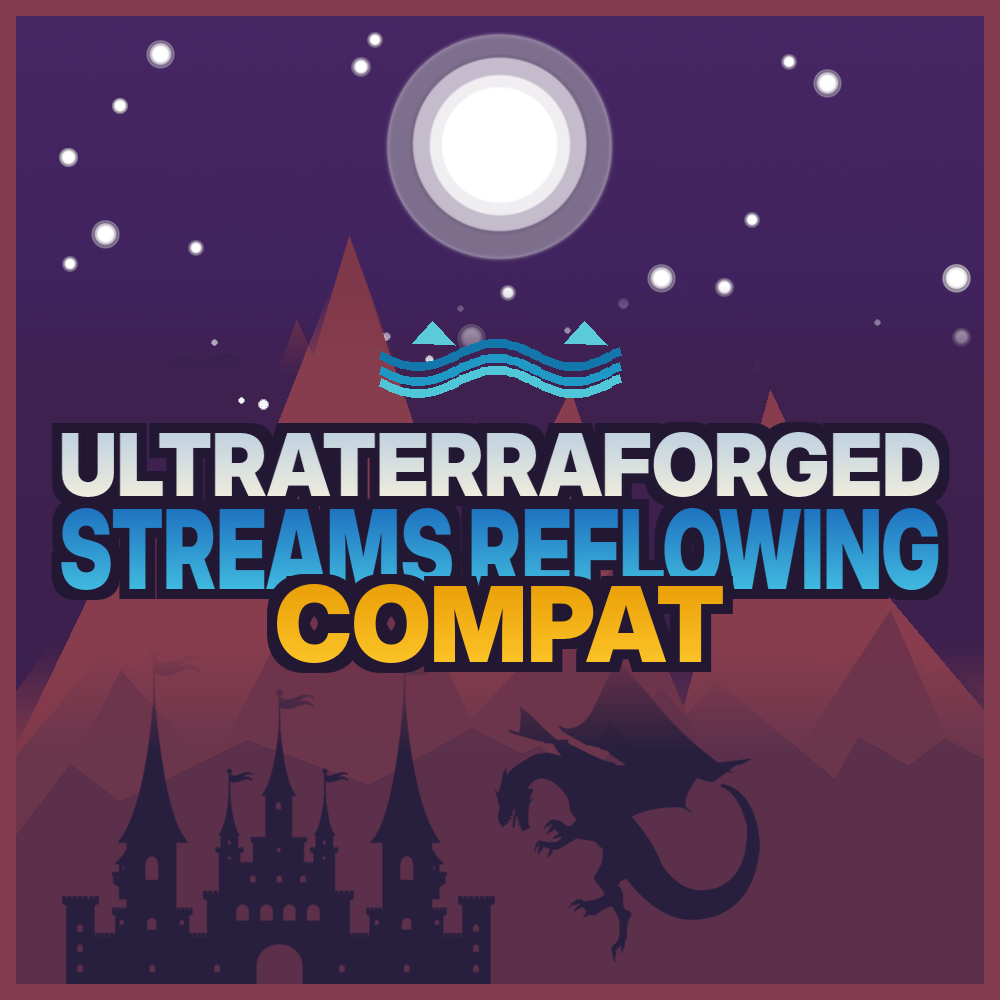

<p align="center"></p>

<p align="center"><a href="https://github.com/Mikaaah/UltraTerraForged-Streams-Currents"></a></p>

<h1 align="center">UltraTerraForged × Streams Reflowing</h1>

<p align="center"><a href="https://www.curseforge.com/minecraft/mc-mods/ultraterraforged-streams-reflowing-compat">CurseForge</a> · <a href="https://github.com/Mikaaah/UltraTerraForged-Streams-Currents/wiki">Wiki</a> · <a href="https://github.com/Mikaaah/UltraTerraForged-Streams-Currents/issues">Report an issue</a> · <a href="https://github.com/Mikaaah/UltraTerraForged-Streams-Currents/blob/main/CHANGELOG.md">Changelog</a></p>

<p align="center"> </p>

Bring Streams Reflowing currents to UltraTerraForged’s native rivers, with height-aware routing and correction against nearby loaded water.

[Download 0.2.1-beta](downloads/ultraterraforged-streams-currents-0.2.1-beta-neoforge-1.21.1.jar?raw=true)

## What it adds

- Adds height-aware Streams currents to UltraTerraForged’s native river paths.
- Corrects final ordinary-water, baked-fluid and boat currents against nearby loaded water.
- Reverses uphill route segments and calms local basins by default.
- Preserves explicit Flow Control edits and never rewrites water or terrain.

## Requirements

| Component | Version |
| --- | --- |
| Minecraft | 1.21.1 |
| NeoForge | 21.1.219 or later within 21.1.x |
| Java | 21 |
| UltraTerraForged | 1.0.2+1.21.1 |
| Streams Reflowing | 2.15.2 |

Install the add-on alongside both original mods on the client and server.

## Setup

Use an UltraTerraForged Overworld with **winding rivers or raised water enabled**. At least one is required for the native river paths used by the adapter.

Keep these settings enabled in `config/streamsreflowing.properties`:

```properties
vanillaWaterFlow=true
flowVanillaRivers=true
```

The operator command `/utfstreams status` reports whether the adapter is active. Currents become available as Streams prepares its flow grids.

## Know before you install

This is a current adapter. It does not change river terrain, repair elevated water steps or fix tributary placement. Water heights ahead and behind determine the downhill direction. Rising route stretches are reversed; local basins are calmed by default. The adapter disables the overlapping generic TerraForged course pass added in Streams 2.15.2 while its native adapter is active.

Current coverage uses terrain-generator estimates. It may differ from saved terrain after preset changes or from water modified by players or other mods. Previously generated Streams fluid blocks are not replaced.

## Guides

[Features](https://github.com/Mikaaah/UltraTerraForged-Streams-Currents/wiki/Features-and-Behavior) · [Configuration](https://github.com/Mikaaah/UltraTerraForged-Streams-Currents/wiki/Configuration-and-Commands) · [Compatibility](https://github.com/Mikaaah/UltraTerraForged-Streams-Currents/wiki/Compatibility-and-Limitations) · [Troubleshooting](https://github.com/Mikaaah/UltraTerraForged-Streams-Currents/wiki/Troubleshooting)

## Credits and license

By Towns & Kingdoms, for UltraTerraForged and Streams Reflowing.

[GPL-3.0-only](LICENSE).
